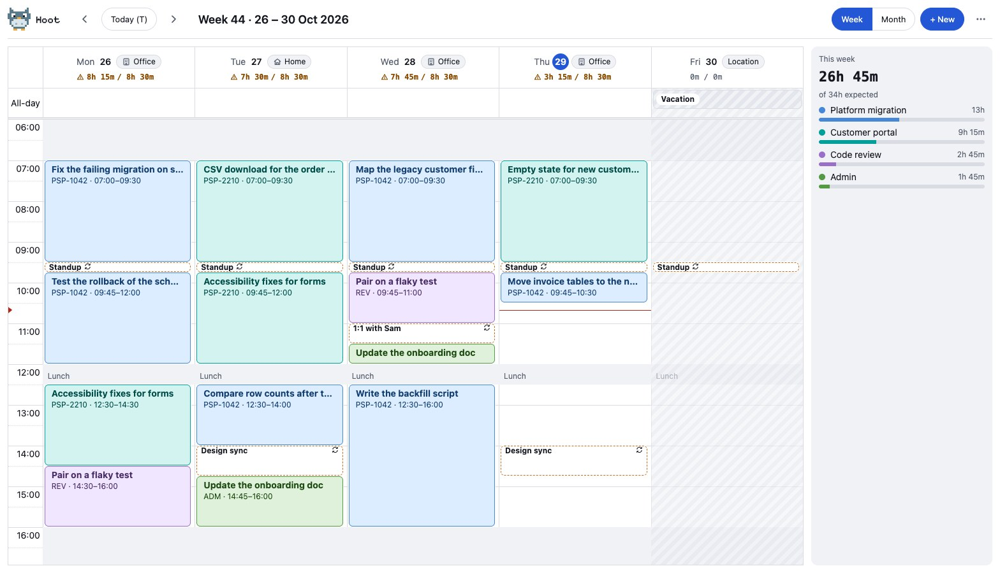
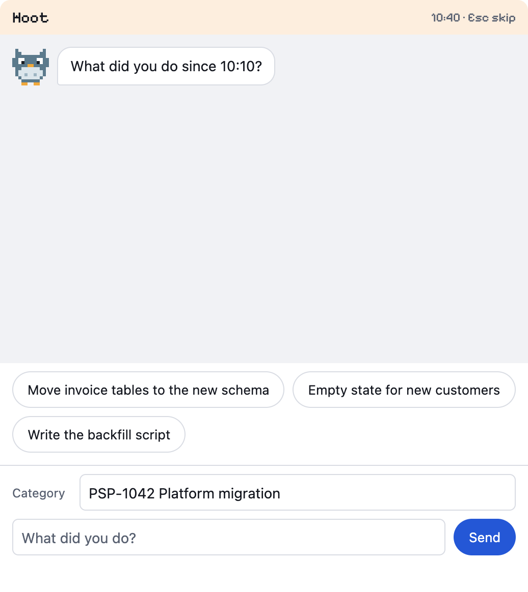
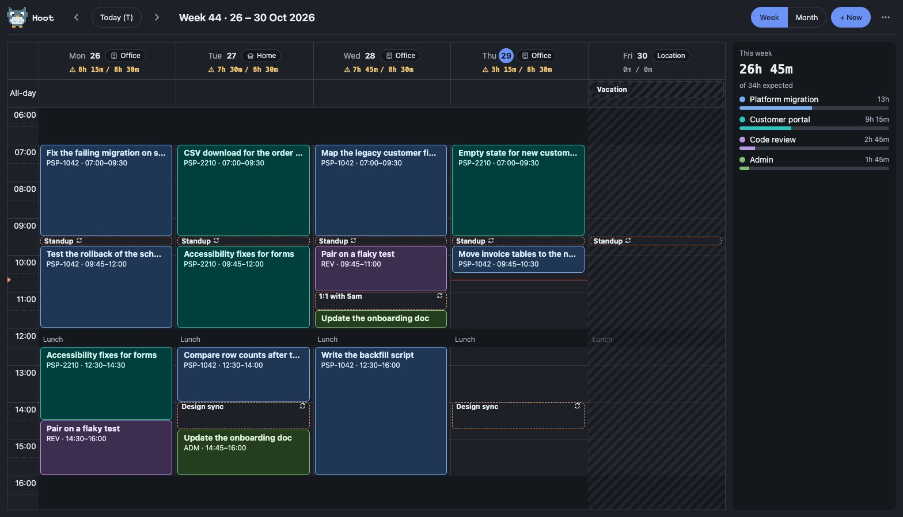
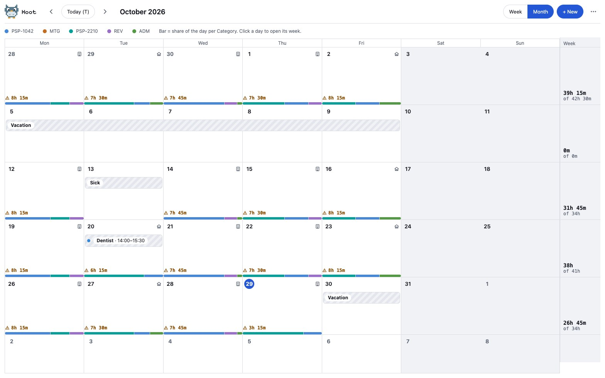
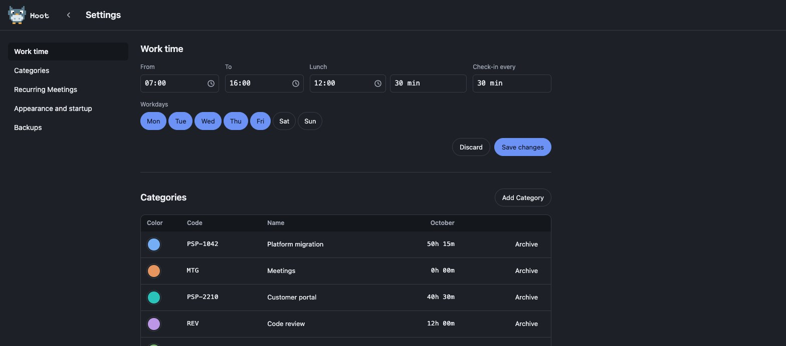
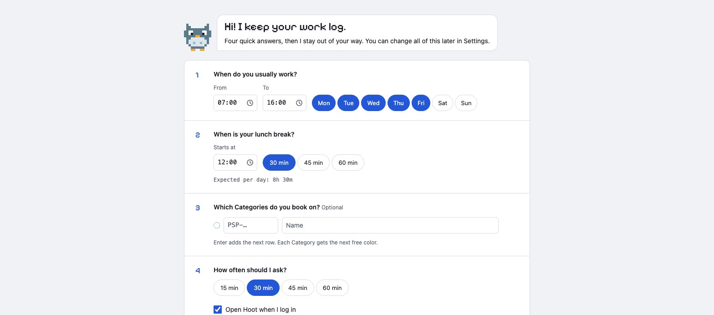

<p align="center">
  
</p>

# Hoot

Hoot is a desktop app that keeps a work log for you. It sits in your menu bar or tray and, every half hour, asks what you have been doing. You answer in one line and the time goes into a calendar. At the end of the month you export the hours to Excel.

I wanted to know where my work time goes, without a spreadsheet and without a stopwatch. Logging has to take a few seconds, or I stop doing it.

Built with Tauri, React and SQLite. Everything stays on your computer.



## How it works

1. Hoot starts when you log in and waits in the tray.
2. At the interval you chose (15, 30, 45 or 60 minutes), a small window opens: "What did you do since 09:05?"
3. Pick a recent answer or type a new one, choose a Category, press Enter.
4. The time block appears in the week or month view.

If you miss a check-in, Hoot notices the gap the next time and asks you to fill it, split it, or leave it empty.

<p align="center">
  
</p>

## Features

- **Check-in window.** Always on top, closes when you answer. Recent answers are one click, and "Yes, still" repeats the last entry. A soft hoot plays when it opens. You can turn it off in Settings.
- **Week and month calendar.** Drag to add an Entry, drag an edge to resize, move Entries with the arrow keys. Undo and redo work. You see hours per day and per week, and a bar with the share of each Category.
- **Categories.** A code (for example a PSP number), a name and one of eight colors. A Category that has Entries is archived instead of deleted.
- **Recurring Meetings.** Add them by hand or import an `.ics` file. You can change one day or the whole series.
- **Absences.** Vacation, sick days and other time away, for whole days or part of a day. The expected hours adjust.
- **Home or office.** Hoot asks once a day and shows the answer in the calendar.
- **Excel export.** One file with two sheets: every Entry, and the hours per Category and day. Choose a month or any range.
- **Backups.** One copy per day, kept on your computer. If the database is damaged, Hoot shows a recovery screen and can restore the newest backup.
- **Light and dark theme.** Follows the system, or you choose.

<table>
  <tr>
    <td width="50%"></td>
    <td width="50%"></td>
  </tr>
  <tr>
    <td width="50%"></td>
    <td width="50%"></td>
  </tr>
</table>

## Install

There are no download files yet, so you build Hoot from source. The first build takes a few minutes.

You need:

- Node.js 22 or newer
- Rust (stable), from [rustup.rs](https://rustup.rs)
- The system tools that Tauri needs. See the [Tauri prerequisites](https://tauri.app/start/prerequisites/) (Xcode command line tools on macOS, WebView2 and the C++ build tools on Windows).

```bash
git clone https://github.com/schmi552/hoot.git
cd hoot
npm install
npm run tauri build
```

The installer is in `src-tauri/target/release/bundle/`.

On the first start, Hoot asks for your work hours, your lunch break, your Categories (optional) and how often it should ask. You can change all of this later in Settings. On macOS, Hoot has no Dock icon. Look for it in the menu bar.

Hoot is developed on macOS. Windows is a build target, but I have not tested it there yet.

## Tech stack

- **App shell:** [Tauri 2](https://tauri.app), for the window, tray, notifications and autostart
- **Backend:** Rust with [rusqlite](https://github.com/rusqlite/rusqlite) (bundled SQLite) and `rusqlite_migration`
- **Export:** [rust_xlsxwriter](https://github.com/jmcnamara/rust_xlsxwriter)
- **Interface:** React 19, TypeScript, [Vite](https://vite.dev)
- **Calendar grid:** [FullCalendar](https://fullcalendar.io) v7
- **Dates:** `temporal-polyfill` and `rrule-temporal` for time zones and repeating Meetings, `ical.js` for `.ics` files
- **Styling:** plain CSS custom properties in three layers (primitive, semantic, component), and the Pixelify Sans font
- **Tests:** Vitest and `cargo test`

Rust stores the data and keeps it safe. TypeScript expands repeating Meetings and draws the screens. Times are stored as UTC seconds with an IANA time zone, so a daylight-saving change does not move your hours.

## Development

```bash
npm install
npm run tauri dev
```

This runs the full app with the Rust backend. The window reloads when you change the code.

| Command | What it does |
|---|---|
| `npm run tauri dev` | Run the app with hot reload |
| `npm run dev` | Run only the web interface on `localhost:1420` (backend calls fail) |
| `npm run typecheck` | Check the TypeScript types |
| `npm test` | Run the Vitest tests and the Rust tests |
| `npm run tauri build` | Build the installers |

### Working in a browser

`dev-mock/` is a fake backend. It lets you open the whole interface in a normal browser, with sample data and a fixed clock (Thursday 29 October 2026, 10:40).

```bash
MOCK=1 npx vite --port 1421
```

Then open `http://localhost:1421`. You can add these to the address:

| Option | Effect |
|---|---|
| `?theme=dark` | Dark theme (`light` and `system` also work) |
| `?demo` | Five weeks of realistic sample data, used for the screenshots |
| `?empty` | No settings, so you see the first-start screens |
| `?fail={"kind":"tooNew","found":99,"supported":4}` | A startup problem (`corrupt` and `migration` also work) |
| `?now=09:35` | Move the clock |
| `#popup` | The check-in window. Run `__emit('debug-popup')` in the console to open it. |

The screenshots in `docs/screenshots/` come from this fake backend. To take them again, keep the dev server running and run `node dev-mock/screenshots.mjs` (Google Chrome must be installed).

### Project layout

```
src/                 React interface: Calendar, Popup, Settings, Onboarding
src/schedule/        Date and schedule code: weeks, Meetings, Absences, .ics
src-tauri/src/       Rust: store (SQLite), safety (backups, recovery), export
docs/design-system/  Tokens, components and the design boards
docs/adr/            Decision records
dev-mock/            The fake backend
GLOSSARY.md          The terms used here: Entry, Category, Meeting, Absence, Gap
```

## Status

Early, version 0.1. There is no license yet, so all rights stay with the author.
